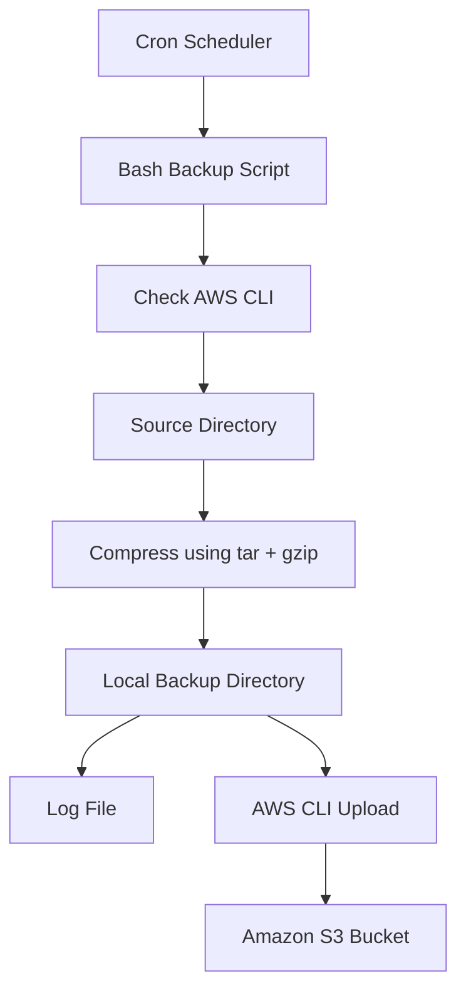

# Bash Scripting Learning Repository

A hands-on repository documenting my journey in Bash Scripting and Linux automation.
It contains practical scripts and exercises covering Bash fundamentals, control flow,
data processing, and Linux task scheduling.

## Topics Covered

### 1. Variables
Practiced Bash variables, scope, predefined variables, and user input.
Covered quoting, arithmetic operations, command substitution, and brace expansion.
Explored exit statuses and environment variables.
Built a foundation for writing reusable and dynamic shell scripts.

### 2. Conditions
Practiced conditional logic using `if`, `else`, and `case` statements.
Worked with numerical, string, logical, and file operators.
Explored regular expressions for input validation and pattern matching.
Applied decision-making logic to control script execution.

### 3. ArrayForLoop
Learned indexed arrays and iterating through collections using `for` loops.
Practiced array element access and handling multiple values.
Used `break` and `continue` to control loop execution.
Explored the `select` statement to build interactive command-line menus.

### 4. whileLoop
Practiced `while` and `until` loops for condition-based iteration.
Learned to process files line by line using `read`.
Explored positional parameters and the `shift` command.
Applied `IFS` and `read -r` for safer file processing.

### 5. Functions
Learned to define and call reusable Bash functions.
Practiced passing arguments and organizing script logic into smaller components.
Explored the `source` command to reuse code from external scripts.
Improved script modularity and maintainability.

### 6. SEDStreamEditor
Practiced text processing and editing using the `sed` stream editor.
Explored pattern matching, regular expressions, and line addressing.
Worked with substitution and text manipulation commands.
Used these techniques to automate text-file operations.

### 7. AWK
Learned structured text processing using AWK records and fields.
Practiced field separation, filtering, and pattern matching.
Explored built-in variables such as `NR`, `NF`, `FS`, and `OFS`.
Used conditions, loops, and `BEGIN`/`END` blocks for data processing.

### 8. at-command
Explored one-time task scheduling using the Linux `at` command.
Practiced scheduling shell scripts for execution at a future time.
Learned to inspect and manage pending jobs.
Understood the role of the `atd` background service.

### 9. cron-command
Practiced recurring task scheduling using `crontab`.
Learned the five-field cron expression format for time-based execution.
Configured scripts to run automatically at scheduled intervals.
Explored Cron service status, execution logs, and output redirection.
--------------------------------------------------------------------------------------------------------------------------------------------------------------

# Automated VM Backup & AWS S3 Replication

## Project Overview

A Bash-based automation project designed to back up important data from a Linux Virtual Machine.

The script compresses source directories, stores timestamped backup archives locally, logs backup operations, and uploads the archives to an Amazon S3 bucket using AWS CLI.

Cron is used to automate backup execution at scheduled intervals.

## Architecture



## Key Features

- **Backup Scheduling:** Automated execution using Cron.
- **Backup Compression:** Compress files using `tar` and `gzip`.
- **Logging:** Record backup operation messages in a log file.
- **AWS Integration:** Upload backup archives to Amazon S3 using AWS CLI.

## Technologies Used

- Linux & Bash Scripting
- Cron
- tar & gzip
- AWS CLI
- Amazon S3

## Usage

```bash
chmod +x backup-script.sh
./backup-script.sh
```

Configure AWS CLI before running:

```bash
aws configure
```

## Project Status

Core functionality implemented and tested, including scheduled execution, local backup creation, compression, logging, and S3 upload.


